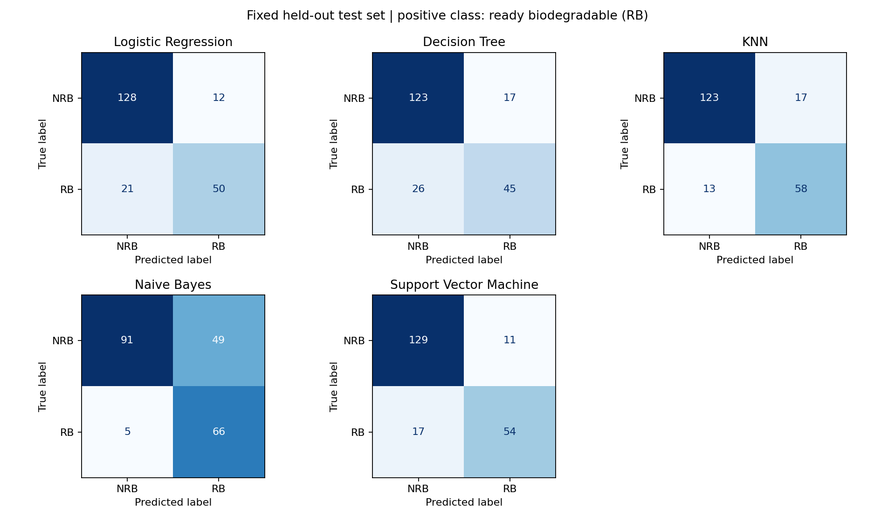

# Biodegradation Model Lab

Machine Learning Assignment 2 | AIMLZG565 | Five-classifier comparison and Streamlit evaluation app.

## a. Problem statement

Predict whether a chemical is ready biodegradable from numerical molecular descriptors. This is a binary classification task: **NRB = 0** (not ready biodegradable) and **RB = 1** (ready biodegradable). Compare Logistic Regression, Decision Tree, K-Nearest Neighbours, Gaussian Naive Bayes and Support Vector Machine on the same held-out data, then inspect their errors in an interactive app.

## b. Dataset description

- **Source:** [UCI QSAR biodegradation](https://archive.ics.uci.edu/dataset/254/qsar+biodegradation), DOI [10.24432/C5H60M](https://doi.org/10.24432/C5H60M).
- **Original size:** 1,055 chemicals, 41 integer/real molecular descriptors and one binary target; exceeds the assignment minimum of 500 instances and 12 features.
- **Original classes:** 699 NRB and 356 RB. Features include atom counts, topological indices, atom-pair frequencies and molecular electronic descriptors.
- **Cleaning:** no missing values; remove three exact duplicate records before splitting. The resulting 1,052 records contain 698 NRB and 354 RB.
- **Split:** stratified 80/20 holdout, `random_state=26`: 841 training records (558 NRB, 283 RB) and 211 test records (140 NRB, 71 RB). `test_data.csv` contains only the held-out rows.
- **Preprocessing:** StandardScaler is fitted within the training pipeline for Logistic Regression, KNN and SVM. Decision Tree and Gaussian Naive Bayes use unscaled descriptors. No preprocessing is fitted to test or uploaded data.
- **License and citation:** CC BY 4.0. Mansouri, K., Ringsted, T., Ballabio, D., Todeschini, R., & Consonni, V. (2013). QSAR biodegradation [Dataset]. UCI Machine Learning Repository. The original semicolon-delimited data is retained in `data/biodeg.csv`; exported train/test files add headers and encode labels numerically.

## c. GitHub Repository Link

[DevOpRohan/ml-biodegradation-lab](https://github.com/DevOpRohan/ml-biodegradation-lab)

The repository includes the app, training source, pinned dependencies, raw/train/test data, all five trained pipelines and machine-readable evaluation results.

## d. Models used

All five models use the same split and all 41 features. Settings were fixed before inspecting the test results; no hyperparameter search or test-set tuning was performed.

| Model | Configuration |
| --- | --- |
| Logistic Regression | StandardScaler; C=1; L2 regularization; LBFGS; max_iter=3000 |
| Decision Tree | Gini criterion; max_depth=6; min_samples_leaf=5 |
| KNN | StandardScaler; 11 neighbours; distance weighting; Euclidean distance |
| Naive Bayes | GaussianNB; var_smoothing=1e-9 |
| Support Vector Machine | StandardScaler; RBF kernel; C=3; gamma=scale |

### Evaluation metrics

Precision, recall and F1 are binary metrics for **RB=1**, not weighted averages. AUC is ROC AUC from the positive-class probability for four models and the signed decision function for SVM. Using continuous scores avoids incorrectly computing AUC from hard labels. Accuracy measures all correct predictions; MCC includes true/false positives and negatives and is useful alongside accuracy for this imbalanced dataset. Undefined precision/recall/F1 is reported as zero; single-class uploads display AUC as N/A.

| ML Model Name | Accuracy | AUC | Precision | Recall | F1 | MCC |
| --- | ---: | ---: | ---: | ---: | ---: | ---: |
| Logistic Regression | 0.8436 | 0.9224 | 0.8065 | 0.7042 | 0.7519 | 0.6416 |
| Decision Tree | 0.7962 | 0.8141 | 0.7258 | 0.6338 | 0.6767 | 0.5315 |
| KNN | 0.8578 | 0.9006 | 0.7733 | 0.8169 | 0.7945 | 0.6866 |
| Naive Bayes | 0.7441 | 0.8878 | 0.5739 | 0.9296 | 0.7097 | 0.5499 |
| Support Vector Machine | 0.8673 | 0.9221 | 0.8308 | 0.7606 | 0.7941 | 0.6980 |

Full precision values are in `results/metrics.csv`. The majority-only test baseline is 140/211 = **0.6635 accuracy**.

### Observations about model performance

| ML Model Name | Observation about model performance |
| --- | --- |
| Logistic Regression | Accuracy 0.8436 and the highest observed AUC (0.9224). Its 12 false positives and 21 false negatives indicate a more conservative RB decision than KNN. A strong linear baseline, but lower RB recall (0.7042) limits its F1. |
| Decision Tree | Accuracy 0.7962, AUC 0.8141 and MCC 0.5315 are the lowest AUC/MCC values here. It misses 26 of 71 RB chemicals. The depth/leaf restrictions control complexity, but this single tree does not separate the classes as well as the other decision rules on this split. |
| KNN | Accuracy 0.8578 and the highest F1 (0.7945), with recall 0.8169. It finds 58 of 71 RB chemicals but produces 17 false positives. Standardized distances give a useful nonlinear comparison; its recall is higher than SVM at the cost of more false positives. |
| Naive Bayes | Highest recall (0.9296): 66 of 71 RB chemicals detected. However, 49 false positives reduce precision to 0.5739 and accuracy to 0.7441. Its Gaussian, conditionally independent feature assumption is restrictive for molecular descriptors; these results illustrate why high recall alone is insufficient. |
| Support Vector Machine | Highest accuracy (0.8673), precision (0.8308) and MCC (0.6980), with AUC 0.9221. It makes 11 false positives and 17 false negatives. The RBF boundary provides the best overall balance in this experiment, although KNN has higher recall and marginally higher F1. |
| Overall winner for this dataset | **SVM**, using MCC as the primary overall comparison metric, supported by the highest accuracy. Logistic Regression has marginally higher AUC and KNN marginally higher F1; neither tiny difference establishes statistical superiority. This conclusion applies only to this fixed split and configuration. |



### Limits of this experiment

A single holdout does not establish a statistically significant ranking. No nested validation, threshold optimization or chemical-family split is claimed. Related chemical structures may still occur across the split even after exact duplicate removal. The app is an educational classifier comparison and does not establish performance on new chemical families or replace experimental testing.

## Run and reproduce

Use Python 3.12 and run from the repository directory:

```bash
python -m venv .venv
source .venv/bin/activate
python -m pip install -r requirements.txt
python train.py --environment local
python -m unittest -v
streamlit run app.py
```

Training writes all five `.joblib` pipelines, the train/test CSVs, metric/report files, confusion-matrix figure and `results/run_metadata.json` (versions, seed, row counts and SHA-256 checksums). The bundled raw data makes retraining independent of UCI availability. Saved scikit-learn artifacts must be loaded with the pinned scikit-learn version.

## BITS Virtual Lab reproduction

Keep the Prayogshala portal tab open. Clone the repository inside `~/workspace`, create the environment there, install `requirements.txt`, and run:

```bash
python train.py --environment bits-virtual-lab
python -m unittest -v
streamlit run app.py --server.address 127.0.0.1
```

Keep the project, models and results inside `~/workspace` so they persist across lab sessions. Capture the terminal results or running app on the actual lab desktop for the submission screenshot.

## Streamlit app

The app provides a labelled test CSV uploader, a model selector, six evaluation metrics, a confusion matrix, classification report, ROC comparison, all-model comparison table and downloadable predictions. It initially evaluates the bundled held-out test data, so evaluators can explore without an upload.

For a custom CSV, use the same 41 feature headers as `test_data.csv` and a `target` column containing 0 or 1. Column order may differ. Missing/extra columns, nonnumeric values, missing/infinite entries, invalid labels, empty input and oversized uploads are rejected. The app accepts up to 10,000 rows and 5 MB. Upload only held-out test data; it is evaluated in memory, not saved by this app or used to retrain. The displayed data source always identifies bundled versus uploaded data.

Deploy on Streamlit Community Cloud using this repository, branch `main`, entry point `app.py`, Python 3.12, and the included `requirements.txt`. No secrets are required.

## Files

```text
app.py                      Interactive Streamlit evaluator
train.py                    Reproducible five-model experiment
ml_utils.py                 Feature schema and evaluation functions
test_project.py             Metric, validation, artifact and app checks
requirements.txt            Pinned direct dependencies
test_data.csv               211 held-out rows, with target
data/biodeg.csv              Original UCI data
data/train_data.csv          841 training rows
model/*.joblib              Five fitted pipelines
results/metrics.csv         Six metrics for all models
results/classification_reports.json
results/confusion_matrices.png
results/run_metadata.json   Execution provenance and checksums
.streamlit/config.toml      App theme and upload limit
```
